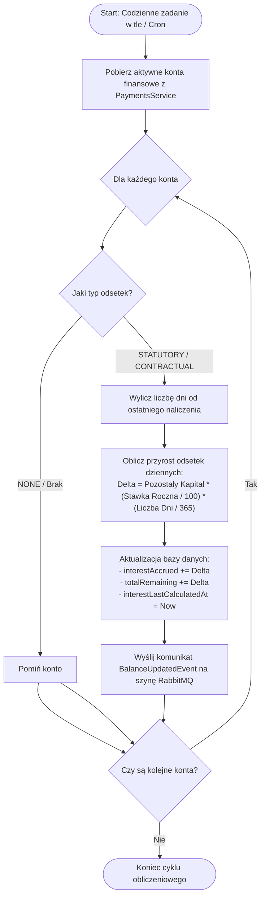
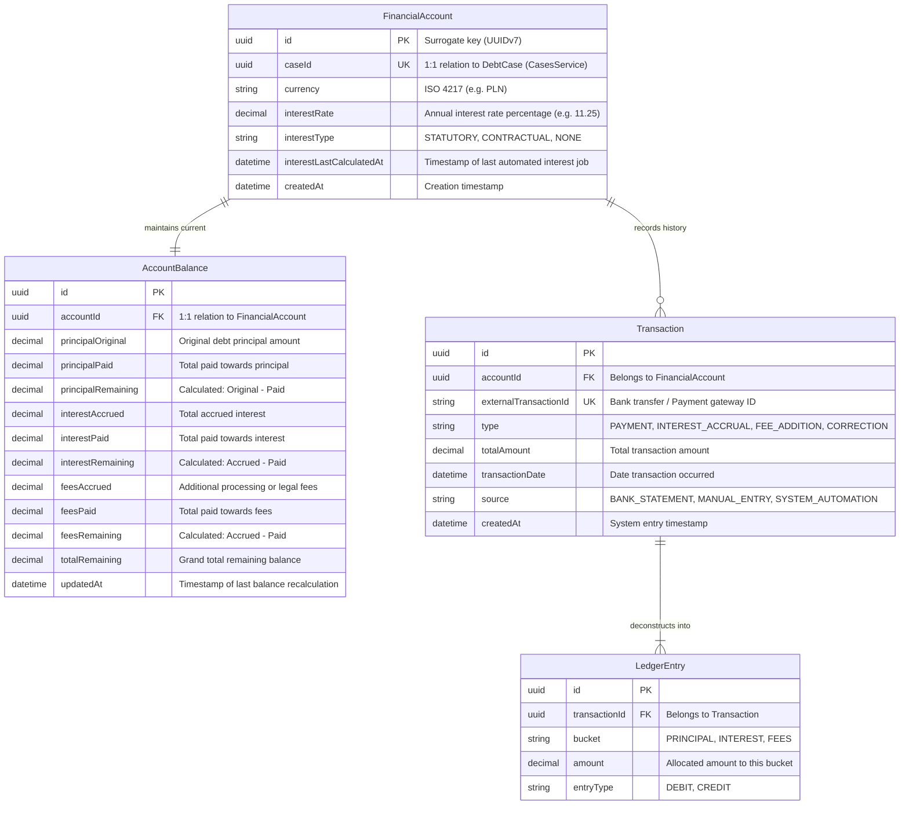

# Algorytm obliczania odsetek

# API

## Inicjalizacja konta

`POST /api/accounts` tworzy konto finansowe dla sprawy oraz zapisuje kapitał
pierwotny, naliczone odsetki i koszty dodatkowe z dnia przekazania.

## Szczegółowe saldo

`GET /api/accounts/{caseId}/balance` zwraca rozbicie salda na kapitał,
odsetki, koszty pozostałe oraz łączną kwotę do spłaty.

# Entities
